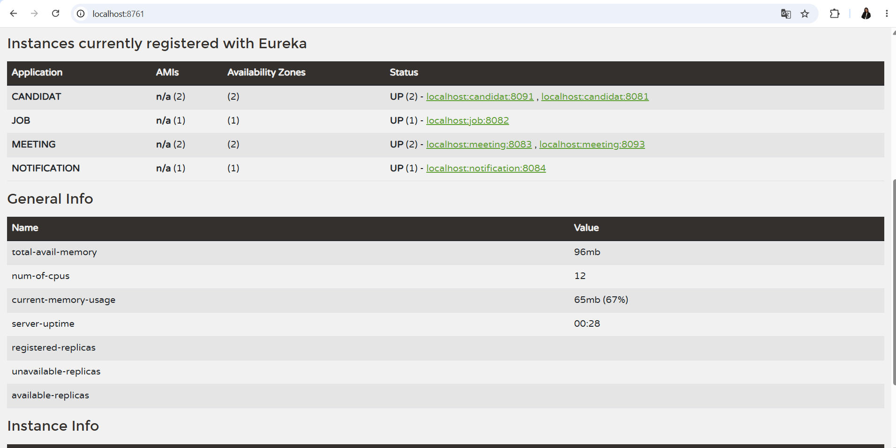

# JobBoard – Microservices avec Eureka Server

Projet réalisé dans le cadre du module **Architecture Web Distribuée** (Esprit 2026-2027, classe 4SSA2).

## Membres de l'équipe
- khaoula ben attia 

## Architecture

| Microservice   | Technologie          | Port(s)      | Nom dans Eureka |
|----------------|----------------------|--------------|-----------------|
| Eureka Server  | Spring Boot 4.0.10   | 8761         | –               |
| Candidat       | Spring Boot 3.2.5 + H2    | 8081, 8091 | CANDIDAT     |
| Job            | Spring Boot 3.2.5 + MySQL | 8082       | JOB          |
| Meeting        | Node.js / Express    | 8083, 8093   | MEETING         |
| Notification   | Python / FastAPI     | 8084         | NOTIFICATION    |

## Dashboard Eureka



## Lancement

1. Démarrer MySQL (XAMPP).
2. Lancer `EurekaApplication` → http://localhost:8761
3. Lancer `CandidatApplication`, `CandidatApplication 8091` et `JobApplication` depuis IntelliJ.
4. Meeting (2 instances) :
   ```powershell
   cd meeting
   npm install
   npm start                        # port 8083
   $env:PORT=8093; npm start        # port 8093 (autre terminal)
   ```
5. Notification :
   ```powershell
   cd notification
   python -m venv venv
   .\venv\Scripts\activate
   pip install -r requirements.txt
   $env:PORT=8084; python -m app.main
   ```

## Endpoints de test
- http://localhost:8083/api/meetings/hello
- http://localhost:8084/api/notifications/hello