# JobBoard – Microservices avec Eureka & Spring Boot Actuator

Projet réalisé dans le cadre du module **Architecture Web Distribuée** – Esprit, classe **4SSA2** (2026-2027).

- **Atelier 1** : Implémentation « Eureka server »
- **Atelier 2** : Observabilité avec Spring Boot Actuator

## Membres de l'équipe

- Khaoula Ben Attia
## Architecture

Tous les microservices s'enregistrent auprès d'un même serveur Eureka et se retrouvent par leur nom.

| Microservice  | Technologie               | Port(s)    | Nom dans Eureka | Santé / info                                  |
|---------------|---------------------------|------------|-----------------|-----------------------------------------------|
| Eureka Server | Spring Boot 4.0.10        | 8761       | –               | –                                             |
| Candidat      | Spring Boot 3.2.5 + H2    | 8081, 8091 | CANDIDAT        | `/candidat/actuator/health`, `/info`, `/metrics` |
| Job           | Spring Boot 3.2.5 + MySQL | 8082       | JOB             | `/actuator/health`, `/info`, `/metrics`       |
| Meeting       | Node.js / Express         | 8083, 8093 | MEETING         | `/health`, `/info`                            |
| Notification  | Python / FastAPI          | 8084       | NOTIFICATION    | `/health`, `/info`                            |

> Candidat utilise `server.servlet.context-path=/candidat` : ses URL commencent par `http://localhost:8081/candidat/...`.

---

## Atelier 1 – Eureka Server

### Partie 1 : serveur Eureka

`EurekaApplication.java`

```java
@SpringBootApplication
@EnableEurekaServer
public class EurekaApplication {
    public static void main(String[] args) {
        SpringApplication.run(EurekaApplication.class, args);
    }
}
```

`application.properties`

```properties
spring.application.name=eureka
server.port=8761
eureka.client.register-with-eureka=false
eureka.client.fetch-registry=false
```

### Partie 2 : Candidat et Job, clients Eureka

Dépendance `spring-cloud-starter-netflix-eureka-client` (Spring Cloud 2023.0.4, compatible avec Spring Boot 3.2.5), annotation `@EnableDiscoveryClient` et :

```properties
eureka.client.service-url.defaultZone=http://localhost:8761/eureka
eureka.client.register-with-eureka=true
eureka.client.fetch-registry=true
eureka.instance.prefer-ip-address=true
```

Deuxième instance de Candidat : configuration IntelliJ dupliquée avec l'option VM `-Dserver.port=8091`.

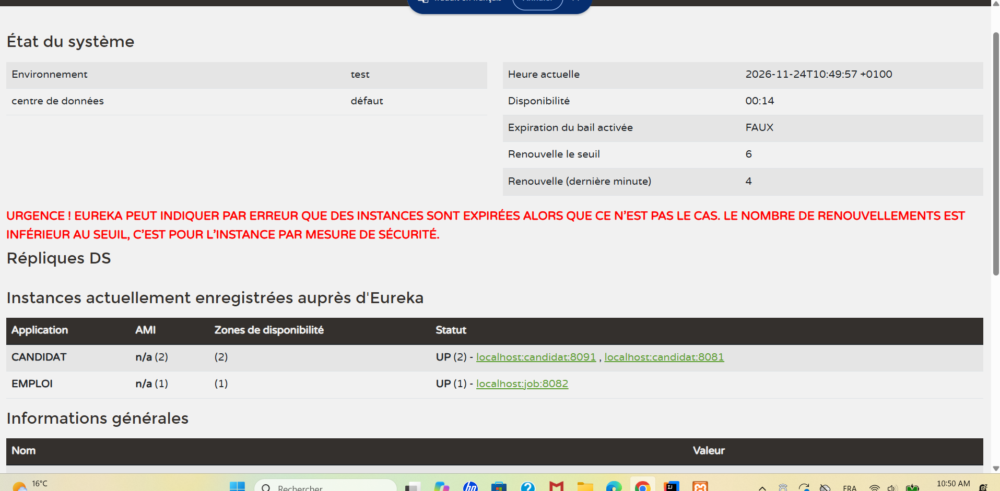

### Partie 3 : Meeting (Node.js) et Notification (Python)

- **Meeting** : `eureka-js-client`, enregistré sous le nom `MEETING`, port lu dans la variable `PORT`.
- **Notification** : `py-eureka-client`, enregistré dans l'événement `lifespan` de FastAPI et arrêté à la fermeture, port lu dans `PORT`.

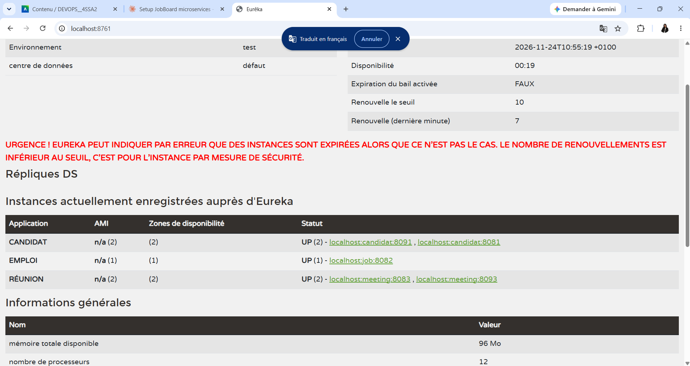

### Dashboard Eureka – Atelier 1

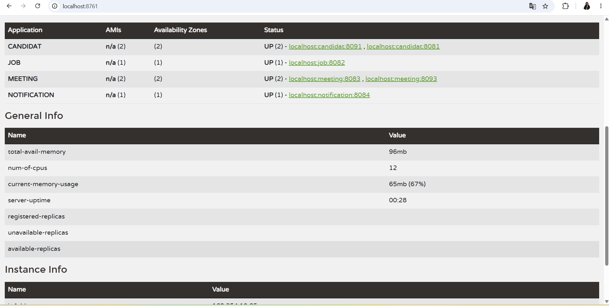

---

## Atelier 2 – Observabilité avec Spring Boot Actuator

### Partie 1 : mise en place d'Actuator (Candidat et Job)

```xml
<dependency>
    <groupId>org.springframework.boot</groupId>
    <artifactId>spring-boot-starter-actuator</artifactId>
</dependency>
```

```properties
management.endpoints.web.exposure.include=health,info,metrics,loggers
management.endpoint.health.show-details=always
eureka.client.healthcheck.enabled=true
management.info.env.enabled=true
info.app.name=candidat
info.app.version=1.0.0
info.app.description=Microservice de gestion des candidats
```

### Partie 2 : panne de la base MySQL (Job)

| MySQL démarré | MySQL arrêté |
|---|---|
| 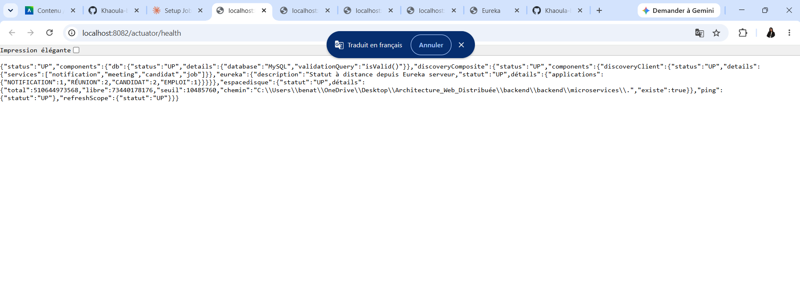 | 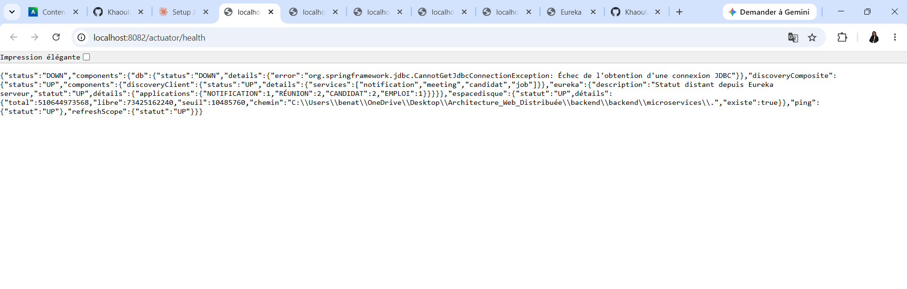 |

Grâce à `eureka.client.healthcheck.enabled=true`, Eureka affiche JOB en **DOWN** pendant la panne, puis de nouveau **UP** après le redémarrage de MySQL.

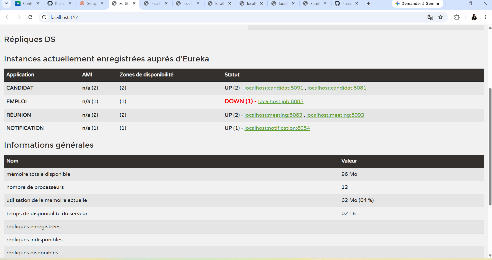
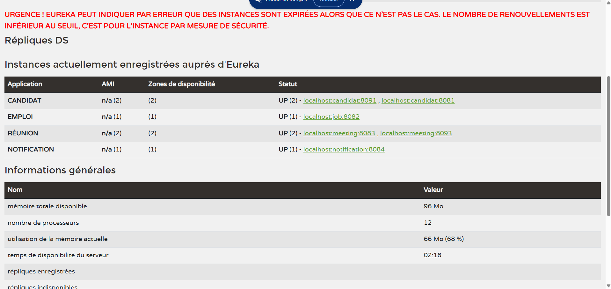

### Étape 4 : /actuator/metrics

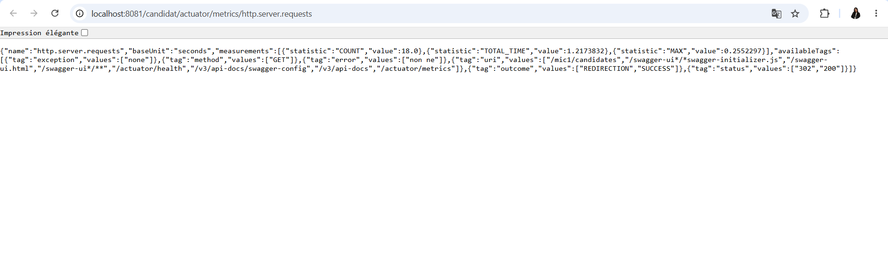
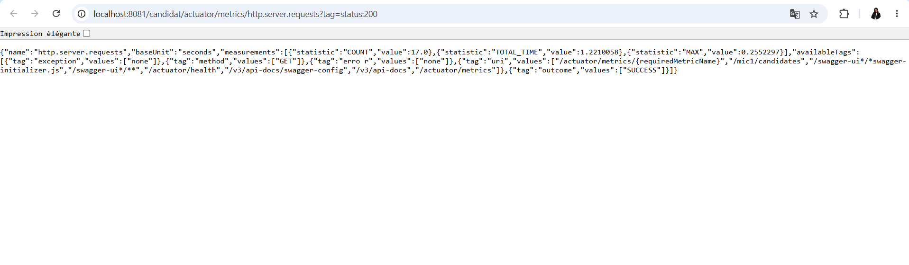

**Question :** combien de requêtes Candidat a-t-il traitées (COUNT) ? Quelle est la durée de la requête la plus lente (MAX) ? Que donne `?tag=status:200` ?

**Réponse :**

- **COUNT = 18** requêtes HTTP traitées depuis le démarrage (`/mic1/candidates`, Swagger et Actuator).
- **MAX = 0,255 s** pour la requête la plus lente. TOTAL_TIME = 1,217 s, soit environ 68 ms par requête en moyenne.
- **`?tag=status:200`** ne garde que les réponses 200 : **COUNT = 17**. La 18ᵉ requête était une redirection **302** (ouverture de `/swagger-ui.html`).

### Partie 5 : santé de Meeting et de Notification

**Meeting** (`src/app.js`, routes déclarées avant le gestionnaire 404) :

```javascript
app.get('/health', (req, res) => res.status(200).json({ status: 'UP' }));

app.get('/info', (req, res) => res.status(200).json({
  app: { name: pkg.name, version: pkg.version, description: pkg.description },
}));
```

Déclaration dans `eureka-js-client` : `statusPageUrl: ${BASE_URL}/info` et `healthCheckUrl: ${BASE_URL}/health`.

| /health | /info |
|---|---|
| 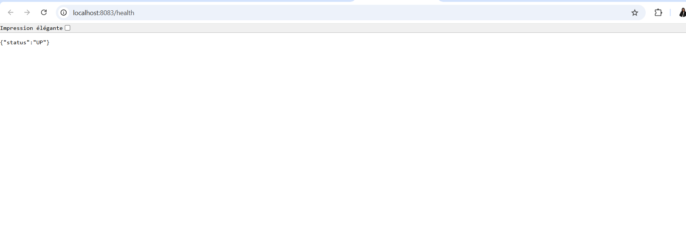 | 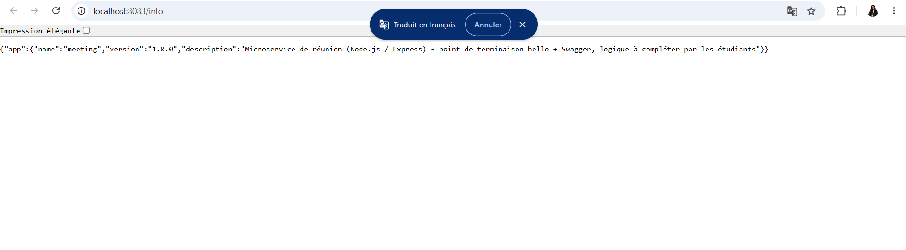 |

**Notification** (`app/main.py`) :

```python
@app.get("/health")
async def health():
    return {"status": "UP"}

@app.get("/info")
async def info():
    return {"app": {"name": "notification", "version": "1.0.0"}}

# dans lifespan :
await eureka_client.init_async(
    ...,
    status_page_url=f"{BASE_URL}/info",
    health_check_url=f"{BASE_URL}/health",
)
```

| /health | /info |
|---|---|
| 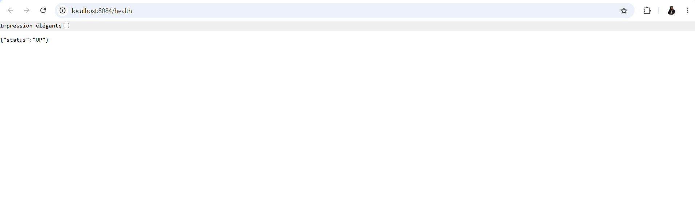 | 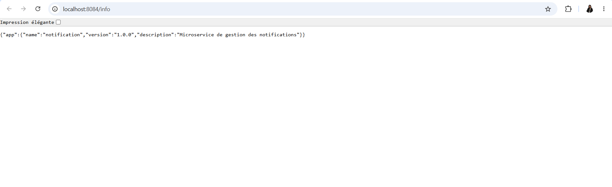 |

Vérification dans le registre `GET http://localhost:8761/eureka/apps/NOTIFICATION` :

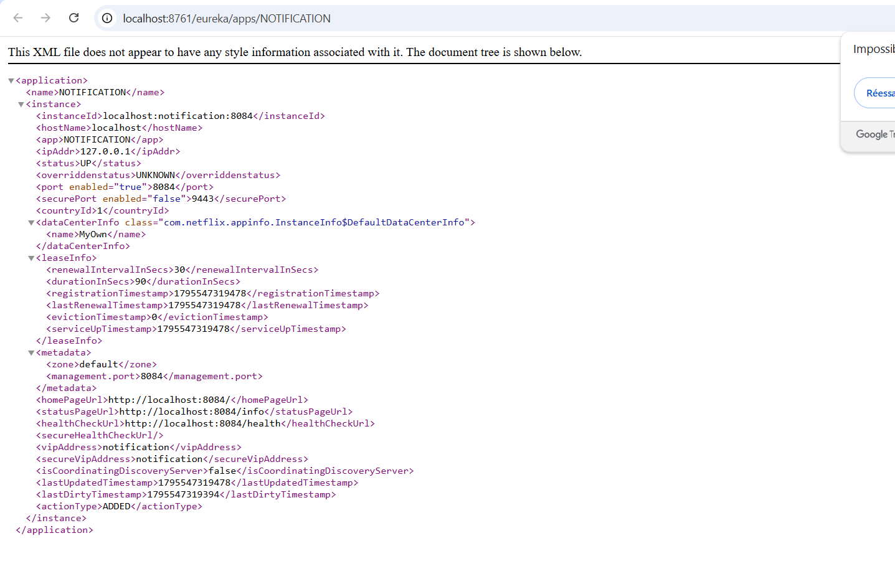

### Dashboard Eureka – Atelier 2

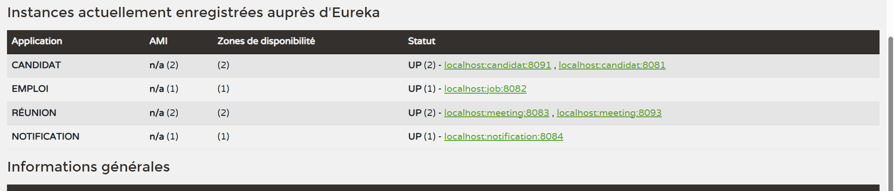

---

## Lancement

1. Démarrer **MySQL** (XAMPP).
2. Lancer `EurekaApplication` → http://localhost:8761
3. Lancer `CandidatApplication`, `CandidatApplication 8091` et `JobApplication` depuis IntelliJ.
4. **Meeting** (deux terminaux) :
   ```powershell
   cd meeting
   npm install
   npm start                       # port 8083
   $env:PORT=8093; npm start       # port 8093
   ```
5. **Notification** :
   ```powershell
   cd notification
   python -m venv venv
   .\venv\Scripts\activate
   pip install -r requirements.txt
   $env:PORT=8084; python -m app.main
   ```

## Endpoints de test

| Service | URL |
|---|---|
| Candidat | http://localhost:8081/candidat/actuator/health |
| Candidat | http://localhost:8081/candidat/actuator/info |
| Job | http://localhost:8082/actuator/health |
| Meeting | http://localhost:8083/health · http://localhost:8083/info · http://localhost:8083/api/meetings/hello |
| Notification | http://localhost:8084/health · http://localhost:8084/info · http://localhost:8084/api/notifications/hello |

📄 Le rapport complet (PDF) se trouve dans `Rendu_TP1_TP2_Eureka_Actuator_Khaoula_Ben_Attia.pdf`.
